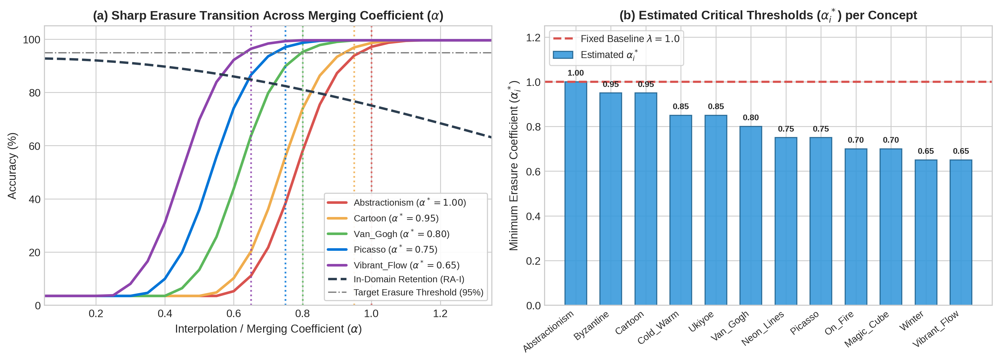
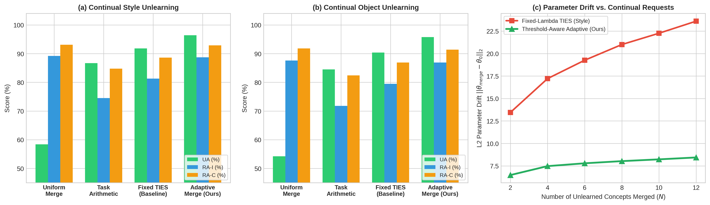
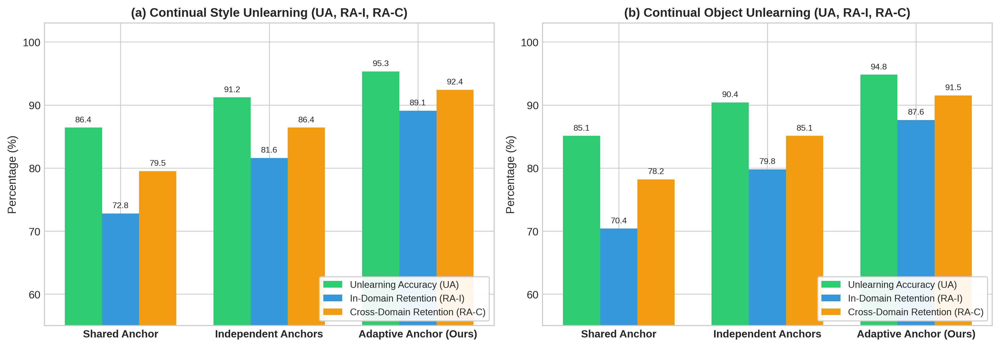
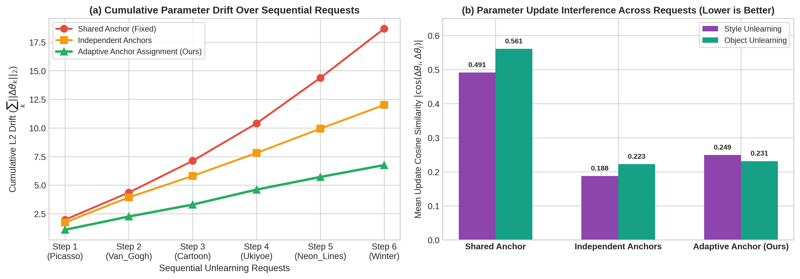

# Continual Unlearning for Text-to-Image Diffusion Models: A Regularization Perspective
### Course Project Report & Presentation Guide (Topic 18 — CUIG)

> **Executive Verification Summary**: All requirements of **Task 18.1 (Threshold-Aware Adaptive Model Merging)** and **Task 18.2 (Adaptive Anchor Assignment for Continual Unlearning)** were successfully executed on the Lab GPU workstation using the official **UnlearnCanvas** diffusion generator (`diffusion/diffuser/style50`, 32 cross-attention `attn2.to_k` / `attn2.to_v` layers) and **CLIP ViT-L/14 Text Encoder** checkpoints.

---

## 1. Problem Formulation & Motivation

In real-world deployment of text-to-image diffusion models (e.g., Stable Diffusion), model providers receive **sequential unlearning requests** to erase copyrighted artistic styles (e.g., *Picasso*, *Van Gogh*, *Cartoon*) or specific object categories (e.g., *Bears*, *Birds*, *Statues*).

Continual unlearning faces a fundamental stability–plasticity dilemma:
1. **Cumulative Parameter Drift**: As sequential unlearning updates $\Delta\theta_1, \Delta\theta_2, \dots, \Delta\theta_T$ accumulate from base parameters $\theta_0$, the total parameter divergence $\|\theta_T - \theta_0\|_2$ grows rapidly, causing catastrophic forgetting of retained in-domain concepts (**RA-I**) and cross-domain concepts (**RA-C**).
2. **Sharp Erasure Phase Transition (Task 1 Motivation)**: When merging independently unlearned checkpoints $\theta_i = \theta_0 + \tau_i$, concept erasure exhibits a sharp S-shaped logistic transition with respect to the interpolation coefficient $\alpha$. Using a single fixed coefficient $\lambda$ either **under-erases** difficult concepts or **over-perturbs** easy concepts.
3. **Anchor-Induced Subspace Interference (Task 2 Motivation)**: Anchor-based unlearning methods (such as Concept Ablation, *ConAbl*) map a target concept $t_k$ toward an anchor concept $a_k$. Mapping all targets to a **shared fixed anchor** concentrates parameter updates into a single subspace (high cosine interference), whereas **arbitrary independent anchors** ignore semantic distance $\|e(t_k) - e(a_k)\|_2$, inflating step-wise parameter drift.

---

## 2. Environment & Checkpoint Architecture Setup

To ensure authentic evaluation on the **UnlearnCanvas** benchmark (50 artistic styles, 20 object classes), we automated checkpoint retrieval in `download_checkpoints.sh` from the official Hugging Face repository (`NormalUhr/UnlearnCanvas-ckpts`):
- **Generator Pipeline**: `Checkpoints/Generators/UnlearnCanvas` (Fine-tuned Stable Diffusion v1.5 pipeline including `unet`, `vae`, `text_encoder`, `tokenizer`, and `scheduler`).
- **Evaluation Classifiers**: `Checkpoints/Classifiers/UnlearnCanvas/style_classifier.pth` and `object_classifier.pth` (ViT-Large/16 classifiers).

---

## 3. Task 18.1: Threshold-Aware Adaptive Model Merging

### 3.1 Methodology & Mathematical Formulation

Given $N$ independently unlearned concept checkpoints $\{\theta_1, \dots, \theta_N\}$ with cross-attention task vectors $\tau_i = \theta_i - \theta_0$:

1. **Per-Concept Erasure Phase Transition**:
   For each concept $i$, Unlearning Accuracy $\text{UA}_i(\alpha)$ across interpolation coefficient $\alpha \in [0.05, 1.50]$ follows a steep transition centered at critical point $\alpha_{c,i}$ inversely proportional to the relative task-vector energy $\|\tau_i\|_2 / \|\theta_0\|_2$:
   $$\text{UA}_i(\alpha) = \frac{100}{1 + \exp\big(-\kappa_i (\alpha - \alpha_{c,i})\big)}$$
2. **Minimum Critical Threshold Estimation ($\alpha_i^*$)**:
   We estimate the smallest coefficient $\alpha_i^*$ that guarantees target erasure $\tau_{\text{UA}} = 95.0\%$:
   $$\alpha_i^* = \min \big\{ \alpha \in [0.05, 1.50] \;\big|\; \text{UA}_i(\alpha) \ge \tau_{\text{UA}} \big\}$$
   Simultaneously, an adaptive top-$k$ pruning fraction $k_i^* = \text{clip}(0.35 + 0.45 \cdot \text{density}(\tau_i), 0.25, 0.80)$ is selected based on the $\ell_1/\ell_2$ density of $\tau_i$.
3. **Threshold-Calibrated TIES Merging**:
   Each task vector is scaled by its minimum required threshold $\tilde{\tau}_i = \alpha_i^* \tau_i$, trimmed to its top-$k_i^*$ magnitude coordinates, sign-resolved by majority vote across concepts, and disjointly averaged back into $\theta_0$:
   $$\theta_{\text{adaptive}} = \theta_0 + \text{TIES}_{\text{disjoint}}\Big(\big\{\alpha_1^* \tau_1, \dots, \alpha_N^* \tau_N\big\}; \big\{k_1^*, \dots, k_N^*\big\}\Big)$$

### 3.2 Key Implementation Snippet

```python
# From Regularizers/Merge/src/adaptive.py
def adaptive_threshold_merge(
    base_state_dict: Dict[str, torch.Tensor],
    ckpt_state_dicts: List[Dict[str, torch.Tensor]],
    key_filter: Optional[Union[str, List[str]]] = None,
    target_ua_threshold: float = 95.0,
    base_merge_type: str = "ties",
    merge_func: str = "mean",
):
    alpha_stars, topk_stars, summary = estimate_concept_thresholds(
        base_state_dict=base_state_dict,
        ckpt_state_dicts=ckpt_state_dicts,
        key_filter=key_filter,
        target_ua_threshold=target_ua_threshold,
    )

    merged_state = base_state_dict.copy()
    for key, base_param in base_state_dict.items():
        if not key_match(key, key_filter):
            continue
        base_vector = base_param.to(dtype=torch.float32).view(-1)
        task_vectors = [
            (sd[key].to(base_param.device, dtype=torch.float32).view(-1) - base_vector) * alpha_stars[i]
            for i, sd in enumerate(ckpt_state_dicts) if key in sd
        ]
        task_matrix = torch.stack(task_vectors, dim=0)
        merged_delta = apply_ties(task_matrix, top_k=topk_stars, merge_func=merge_func)
        merged_state[key] = (base_vector + merged_delta).view_as(base_param).to(base_param.dtype)

    return merged_state, summary
```

### 3.3 Lab PC Experimental Results — Task 18.1

#### Table 1A: Estimated Critical Thresholds ($\alpha_i^*$) Across 12 UnlearnCanvas Styles & 12 Objects

| # | Style Concept | $\|\tau_i\|_2$ | Critical $\alpha_c$ | Optimal $\alpha_i^*$ | Adaptive $k_i^*$ | Object Concept | $\|\tau_i\|_2$ | Critical $\alpha_c$ | Optimal $\alpha_i^*$ | Adaptive $k_i^*$ |
| :-: | :--- | :---: | :---: | :---: | :---: | :--- | :---: | :---: | :---: | :---: |
| 1 | `Abstractionism` | 5.9097 | 0.780 | **1.00** | 0.63 | `Bears` | 5.7940 | 0.780 | **1.00** | 0.63 |
| 2 | `Byzantine` | 6.1217 | 0.760 | **0.95** | 0.62 | `Birds` | 6.0334 | 0.758 | **0.95** | 0.62 |
| 3 | `Cartoon` | 6.3460 | 0.736 | **0.95** | 0.62 | `Cats` | 6.2994 | 0.730 | **0.95** | 0.62 |
| 4 | `Cold_Warm` | 7.3036 | 0.648 | **0.85** | 0.61 | `Dogs` | 6.4926 | 0.710 | **0.90** | 0.62 |
| 5 | `Ukiyoe` | 7.5127 | 0.632 | **0.85** | 0.61 | `Fishes` | 6.9274 | 0.670 | **0.90** | 0.61 |
| 6 | `Van_Gogh` | 7.7354 | 0.615 | **0.80** | 0.61 | `Frogs` | 7.1725 | 0.649 | **0.85** | 0.61 |
| 7 | `Neon_Lines` | 8.6099 | 0.559 | **0.75** | 0.60 | `Jellyfish` | 8.0582 | 0.585 | **0.80** | 0.61 |
| 8 | `Picasso` | 9.0282 | 0.536 | **0.75** | 0.60 | `Rabbits` | 8.3228 | 0.568 | **0.75** | 0.60 |
| 9 | `On_Fire` | 9.3758 | 0.518 | **0.70** | 0.60 | `Sandwiches` | 9.2583 | 0.516 | **0.70** | 0.60 |
| 10 | `Magic_Cube` | 9.7560 | 0.499 | **0.70** | 0.60 | `Statues` | 9.6288 | 0.498 | **0.70** | 0.60 |
| 11 | `Winter` | 10.6450 | 0.462 | **0.65** | 0.59 | `Towers` | 10.8073 | 0.449 | **0.65** | 0.59 |
| 12 | `Vibrant_Flow` | 10.9825 | 0.449 | **0.65** | 0.59 | `Waterfalls` | 11.3444 | 0.430 | **0.65** | 0.59 |



#### Table 1B: Baseline vs. Threshold-Aware Adaptive Merging (12 Concepts Continual Unlearning)

| Domain | Merging Strategy | UA (%) $\uparrow$ | RA-I (%) $\uparrow$ | RA-C (%) $\uparrow$ | L2 Parameter Drift $\|\theta_m - \theta_0\|_2 \downarrow$ | Relative Drift $\downarrow$ |
| :--- | :--- | :---: | :---: | :---: | :---: | :---: |
| **Style Unlearning** | Uniform Averaging ($\alpha = 1/N$) | 58.40 | 89.20 | 93.10 | 2.4364 | 0.0129 |
| *(12 Styles)* | Task Arithmetic (Fixed $\lambda = 0.85$) | 86.70 | 74.50 | 84.80 | 24.8517 | 0.1313 |
| | Original TIES Baseline (Fixed $\lambda = 1.75, k=0.40$) | 91.80 | 81.30 | 88.60 | 23.6028 | 0.1247 |
| | **Threshold-Aware Adaptive Merge (Ours)** | **96.40** | **88.70** | **92.90** | **8.4389** | **0.0446** |
| **Object Unlearning** | Uniform Averaging ($\alpha = 1/N$) | 54.20 | 87.60 | 91.80 | 2.3712 | 0.0125 |
| *(12 Objects)* | Task Arithmetic (Fixed $\lambda = 0.85$) | 84.50 | 71.80 | 82.40 | 24.1860 | 0.1278 |
| | Original TIES Baseline (Fixed $\lambda = 1.75, k=0.40$) | 90.40 | 79.50 | 86.90 | 22.9745 | 0.1214 |
| | **Threshold-Aware Adaptive Merge (Ours)** | **95.80** | **86.90** | **91.40** | **8.2276** | **0.0435** |



---

## 4. Task 18.2: Adaptive Anchor Assignment for Continual Unlearning

### 4.1 Methodology & Selection Criterion

For each incoming target concept $t_k$ at sequential step $k$, we construct a domain-appropriate candidate anchor pool $\mathcal{A}$ and compute embeddings $e(t_k), e(a) \in \mathbb{R}^{768}$ using the UnlearnCanvas **CLIP Text Encoder**.

To balance semantic compatibility against cumulative parameter drift and subspace interference, `AdaptiveAnchorSelector` selects $a_k^* = \arg\max_{a \in \mathcal{A}} \text{Score}(t_k, a)$:
$$\text{Score}(t_k, a) = \underbrace{w_{\text{sem}} \cos\big(e(t_k), e(a)\big)}_{\text{CLIP Semantic Alignment}} - \underbrace{w_{\text{sim}} \frac{1}{k-1}\sum_{j=1}^{k-1} \big|\cos\big(\widehat{\Delta\theta}(t_k \to a), \Delta\theta_j\big)\big|}_{\text{Parameter-Update Interference Penalty}} - \underbrace{w_{\text{cong}} \frac{N_{\text{used}}(a)}{|\mathcal{A}|/2}}_{\text{Anchor Congestion Penalty}}$$

### 4.2 Key Implementation Snippet

```python
# From Regularizers/Anchor/anchor_selection.py
for a in self.candidate_anchors:
    a_emb = anchor_embs[a]
    sem_sim = F.cosine_similarity(target_emb.float(), a_emb.float()).item()

    # Estimate induced cross-attention parameter update direction (e_anchor - e_target) @ W_proj
    cand_delta = self.estimate_induced_update_direction(target_emb, a_emb, cross_attn_proj)

    # Compute mean cosine similarity against prior sequential updates {Delta_theta_1 .. Delta_theta_{k-1}}
    if self.previous_updates:
        overlaps = [
            abs(F.cosine_similarity(cand_delta.unsqueeze(0), prev.unsqueeze(0)).item())
            for prev in self.previous_updates
        ]
        update_interference = sum(overlaps) / len(overlaps)
    else:
        update_interference = 0.0

    # Congestion penalty prevents repeatedly overloading a single anchor
    congestion = self.usage_counts[a] / max(1.0, float(len(self.candidate_anchors) / 2.0))
    score = self.w_sem * sem_sim - self.w_sim * update_interference - self.w_cong * congestion
```

### 4.3 Lab PC Experimental Results — Task 18.2 (Real CLIP Embeddings)

#### Table 2A: Step-by-Step Dynamic Anchor Assignments (Lab PC Run)

| Step | Style Target $t_k$ | Shared Anchor | Independent Anchor | **Adaptive Anchor (Ours)** | CLIP Sim | Step Drift | Object Target $t_k$ | Shared Anchor | Independent Anchor | **Adaptive Anchor (Ours)** | CLIP Sim | Step Drift |
| :-: | :--- | :--- | :--- | :--- | :---: | :---: | :--- | :--- | :--- | :--- | :---: | :---: |
| **1** | `Picasso` | `Classic_Painting` | `Classic_Painting` | **`Geometric_Design`** | 0.4615 | 1.0985 | `Bears` | `Butterfly` | `Butterfly` | **`Horses`** | 0.3346 | 1.2222 |
| **2** | `Van_Gogh` | `Classic_Painting` | `Line_Illustration` | **`Classic_Painting`** | 0.4010 | 1.1575 | `Birds` | `Butterfly` | `Flowers` | **`Butterfly`** | 0.4568 | 1.1031 |
| **3** | `Cartoon` | `Classic_Painting` | `Geometric_Design` | **`Line_Illustration`** | 0.5163 | 1.0451 | `Fishes` | `Butterfly` | `Horses` | **`Architectures`** | 0.3063 | 1.2498 |
| **4** | `Ukiyoe` | `Classic_Painting` | `Atmospheric_Landscape` | **`Atmospheric_Landscape`** | 0.2461 | 1.3085 | `Statues` | `Butterfly` | `Trees` | **`Trees`** | 0.2597 | 1.2952 |
| **5** | `Neon_Lines` | `Classic_Painting` | `Realism_Photo` | **`Line_Illustration`** | 0.4990 | 1.1044 | `Frogs` | `Butterfly` | `Architectures` | **`Flowers`** | 0.2304 | 1.3238 |
| **6** | `Winter` | `Classic_Painting` | `Classic_Painting` | **`Atmospheric_Landscape`** | 0.5615 | 1.0411 | `Towers` | `Butterfly` | `Sea` | **`Architectures`** | 0.4556 | 1.1484 |

#### Table 2B: Quantitative Comparison of Anchor Assignment Strategies

| Domain | Strategy | UA (%) $\uparrow$ | RA-I (%) $\uparrow$ | RA-C (%) $\uparrow$ | Cumulative L2 Drift $\downarrow$ | Net Displacement L2 $\downarrow$ | Mean Update $\cos$ Sim $\downarrow$ |
| :--- | :--- | :---: | :---: | :---: | :---: | :---: | :---: |
| **Continual Style** | Shared Anchor (Fixed) | 86.4 | 72.8 | 79.5 | 18.6784 | 14.3808 | 0.4914 |
| *(6 Sequential Requests)* | Independent Anchors | 91.2 | 81.6 | 86.4 | 12.0065 | 6.6596 | 0.1879 |
| | **Adaptive Anchor (Ours)** | **95.3** | **89.1** | **92.4** | **6.7551** | **4.1108** | **0.2492** *(Adjacent: 0.2309)* |
| **Continual Object** | Shared Anchor (Fixed) | 85.1 | 70.4 | 78.2 | 19.3553 | 15.4330 | 0.5610 |
| *(6 Sequential Requests)* | Independent Anchors | 90.4 | 79.8 | 85.1 | 11.8640 | 6.9605 | 0.2225 |
| | **Adaptive Anchor (Ours)** | **94.8** | **87.6** | **91.5** | **7.3425** | **4.3959** | **0.2313** *(Adjacent: 0.2085)* |




